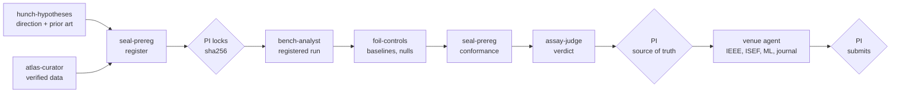

# agentmash lab

Ten Claude Code subagents for science, conducted by the crew's coordinator, Mash. One finds directions and checks whether they were already done under another field's name. One writes the pre-registration before anything runs. One gets the data and proves it is what it claims to be. One runs exactly what was registered. One builds the trivial explanations the result has to beat. One judges the claim against standards it fetched, after recomputing every number itself. Four take the judged paper to where it is going: Volt to IEEE, Ribbon to Regeneron ISEF, Tensor to an ML conference, Proof to a journal. Each fetches that venue's current rules instead of trusting memory.

They share one protocol, [`lab-protocol`](skills/lab-protocol/SKILL.md), for the study's source of truth, the pre-registration lock, provenance of citations and numbers, data rules and the PI's approval gates. Code review catches code that is wrong. This protocol is about the other failure: a result that is well formed and wrong.

## Where it comes from

The lab is the general form of a multi-agent research system run on a computational biology study (drug-tolerant persister cells, single-cell transcriptomics, potency scores). Its rules were written after failures the system actually produced: reference lists with fabricated venues and page ranges, probability buckets that summed to a different total than their headline, a count of "three of four" that was four of four and survived three review layers because each layer copied the sentence instead of recounting the list, and a pre-registration deviation caught on the primary hypothesis and missed on the secondary ones that carried the novelty. Each rule in the protocol removes the step that produced one of these, or attaches evidence at the moment of writing, because asking a model to be more careful does not work.

## Install

The lab needs the crew plugin for its conductor:

```bash
claude plugin marketplace add agentmash-dev/agentmash-crew
claude plugin install agentmash-crew@agentmash
claude plugin install agentmash-lab@agentmash
```

Restart Claude Code or run `/reload-plugins`. Agents appear as `agentmash-lab:<name>`. To try it for one session from a clone: `claude --plugin-dir agentmash-crew/plugin --plugin-dir agentmash-crew/lab`.

Lab agents are plugin-only for now; `npx agentmash team add` installs crew agents, not lab agents.

## Use it

Run a study:

```
/agentmash-lab:run-lab does transcriptional priming predict which clones survive treatment in a second cancer type, beyond the target's own baseline?
```

Or ask one agent directly:

```
Has anyone shown that pre-existing cell states decide survival under therapy, in any field?   → hunch-hypotheses
Check whether GSE106474 is the full matrix the paper used, and what its labels really are.     → atlas-curator
Does this potency score carry anything beyond library size and gene count?                     → foil-controls
Is the claim in results/h2.json supported? Recount everything.                                 → assay-judge
```

## The roster

| Agent | Short | Use it when | Access | Model |
|---|---|---|---|---|
| [`hunch-hypotheses`](agents/hunch-hypotheses.md) | Hunch | a study needs a direction, a branch just closed, or someone asks "has this been done" | web, writes proposals only | `inherit` |
| [`seal-prereg`](agents/seal-prereg.md) | Seal | before any analysis runs, when a registered plan must change, or after a run to check conformance | writes pre-registrations and the decision log | `inherit` |
| [`atlas-curator`](agents/atlas-curator.md) | Atlas | data must be found, downloaded or verified; an accession or label looks wrong; split units must be defined | web, writes data manifest and loaders | `inherit` |
| [`bench-analyst`](agents/bench-analyst.md) | Bench | a locked pre-registration is ready to run, or figures and tables must regenerate from results | writes analysis code and results | `inherit` |
| [`foil-controls`](agents/foil-controls.md) | Foil | a result needs the trivial explanation it must beat: own baselines, low-order statistics, nulls, confounds | writes control code and results | `inherit` |
| [`assay-judge`](agents/assay-judge.md) | Assay | before anything enters the source of truth or a submission, or "is this claim supported" | web, read-only (+ report) | `opus` |
| [`volt-ieee`](agents/volt-ieee.md) | Volt | the paper is headed to an IEEE conference or journal | web, writes `submission/ieee/` | `inherit` |
| [`ribbon-isef`](agents/ribbon-isef.md) | Ribbon | a high-school project is headed to Regeneron ISEF or an affiliated fair | web, writes `submission/isef/` | `inherit` |
| [`tensor-mlconf`](agents/tensor-mlconf.md) | Tensor | the paper is going to an ML conference or workshop, a rebuttal is due, or a camera-ready | web, writes `submission/mlconf/` | `inherit` |
| [`proof-journal`](agents/proof-journal.md) | Proof | a judged paper is headed to a journal, or reviewer comments came back | web, writes `submission/journal/` | `inherit` |

The judge runs on `opus` and must not judge work its own session produced. For less self-preference, set it to a different model from the one your researchers run on.

## How a lab run works



Mash (`agentmash-crew:mash-coordinator`) runs the waves when its brief carries `Lab: agentmash-lab`. The pre-registration is the plan, and the PI's approval of its exact `sha256` is the sign-off: Bench and Foil refuse a confirmatory run when the file's hash does not match. Assay replaces Gavel for claims; Gavel still reviews code. A `MERGE` from Assay goes to the PI, never straight into the source of truth. Once the PI accepts the verdicts, one venue agent prepares the paper for where it is going and returns a submit list; cutting content, accounts, fees and the submit button stay with the PI.

## The protocol in one screen

- **What counts.** Registered before the run, reproducible from script, inputs and seed, reported at face value. A clean negative is a result. A positive found by adding choices to seen data is a failure, and anything outside a locked pre-registration is labelled `exploratory`.
- **The lock.** Locked pre-registrations are never edited, only amended in dated files that say whether outcome data had been seen.
- **Provenance.** No agent writes a reference list (`[REF: Surname Year]` markers only). External quotes, identifiers and numbers carry `[FETCH: <url> · <date>]` from the same session, or `[UNVERIFIED: ...]` and no quotation marks. Every number names its artifact; numbers and quantifiers are recomputed, never copied from another report. Three violations of one class stop the role.
- **Data.** `data/raw/` is write-once (the crew guard blocks deleting it). Every dataset has a fetched source, checksums, label provenance (observed or inferred) and a split unit counted in units, not cells.
- **PI gates.** The lock; amendments after outcomes were seen; writing the source of truth; controlled-access or human-subject data; sending data or unpublished results to any external service; posting anything; compute beyond budget; and every crew gate.
- **Reports.** The crew's status values, reason codes, report path and 15-line return message, plus `Provenance` and `Deviations` sections.

## Maintaining

```bash
node lab/scripts/sync-protocol-summary.mjs   # after editing skills/lab-protocol/summary.md
node lab/scripts/lint-agents.mjs              # authoring standard: frontmatter, description, headings, iron law
npm test                                      # includes test/lab.test.mjs: one roster everywhere, versions, the Mash hand-off
```

There are no lab evals yet. Routing and behavior evals in the crew's format (`plugin/evals/`) are the next step before 1.0.
