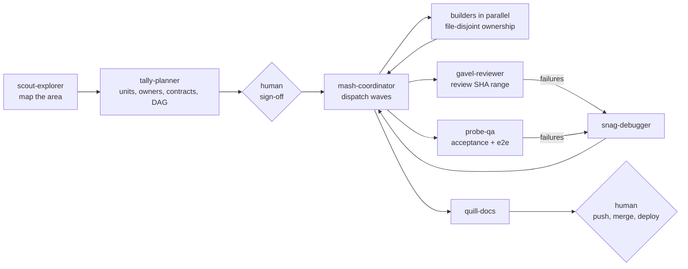

# agentmash crew

Twenty-two Claude Code subagents that work as one crew on one repository. A planner splits the work so no two agents own the same file. A coordinator dispatches builders in parallel and integrates what they produce. Reviewers verify claims against the diff instead of trusting reports. A debugger finds root causes before anyone patches. All of them follow one shared protocol for ownership, [agentmash](https://agentmash.dev) heads-ups, git hygiene in a shared working tree, human approval gates and machine-readable reports.

Each agent is also a vinyl-toy mascot from [agentmash](https://agentmash.dev).

This file covers the plugin in depth. For installing a named team into a repository, the CLI and the project layout, see the [repository README](../README.md).

## What's inside

| Path | What it is |
|---|---|
| `agents/*.md` | 22 role agents, one file each |
| `skills/crew-protocol/` | The shared protocol every agent preloads: task files, ownership map, heads-up procedure, git rules, approval gates, evidence standard, status values and report contract |
| `skills/run-crew/` | Playbook for the main session to lead a crew run: scout, plan, human sign-off, dispatch waves, review, integrate |
| `hooks/` | A PreToolUse guard that blocks destructive git and approval-gated commands for crew agents only, with tests |
| `evals/` | 29 eval cases: routing, near-miss routing between siblings, a named-team case, and behavior checks |
| `scripts/` | `lint-agents.mjs` (authoring standard checks) and `sync-protocol-summary.mjs` (keeps the protocol summary identical in all agents) |

## Install

The repository root is a plugin marketplace named `agentmash` (see `.claude-plugin/marketplace.json`):

```bash
claude plugin marketplace add agentmash-dev/agentmash-crew
claude plugin install agentmash-crew@agentmash
```

Or try it for one session without installing, from a clone:

```bash
git clone https://github.com/agentmash-dev/agentmash-crew
claude --plugin-dir agentmash-crew/plugin
```

Restart Claude Code or run `/reload-plugins` after installing. Agents appear as `agentmash-crew:<name>`.

The plugin installs the whole crew for you, in every project. To give one repository a named team that every teammate gets with `git pull`, use `npx agentmash team add "agentmash crew" --agents pipe,flex,probe` instead (the agentmash CLI, 0.4.0 or later). Team agents live in the project's `.claude/agents/` under their bare names (`pipe-backend`). The [repository README](../README.md#teams) explains teams.

## Use it

Run a whole task with the crew:

```
/agentmash-crew:run-crew add team invite links: admins create a link, it expires in 7 days, invitees join the workspace
```

Or call one agent directly, in plain language. Claude routes by each agent's description:

```
Review main..HEAD before I merge, including a security pass.        → gavel-reviewer
Checkout tests fail with "Cannot read properties of undefined".      → snag-debugger
Break the CSV export feature into units for parallel agents.         → tally-planner
```

You can also name the agent: "Use the agentmash-crew:index-database agent to write a zero-downtime migration for …". In a project with a team install, the same agent is `index-database`.

## The roster

| Agent | Mascot | Use it when | Access | Model |
|---|---|---|---|---|
| [`mash-coordinator`](agents/mash-coordinator.md) | Mash | an approved tally-planner plan is ready to run, 'run the crew on this' with a plan in place, or parallel crew work needs integrating | writes owned files, dispatches agents | `inherit` |
| [`flex-frontend`](agents/flex-frontend.md) | Flex | building or changing a web component, page, layout, form, style or interaction, implementing a design ("make this UI", "fix this layout"), changing design tokens or client state, or when a plan assigns UI files | writes owned files | `inherit` |
| [`pipe-backend`](agents/pipe-backend.md) | Pipe | adding or changing a server endpoint, service, background job or business rule, when asked to 'build the API for X', or to fix a server-side bug inside backend-owned files | writes owned files | `inherit` |
| [`swipe-mobile`](agents/swipe-mobile.md) | Swipe | a task touches the mobile app: a new screen or navigation flow, gestures, deep links, in-app push handling, native permissions or native config | writes owned files | `inherit` |
| [`index-database`](agents/index-database.md) | Index | a task adds or changes tables, columns, relations or indexes, asks for a migration, names a slow query, or when migrations collide across branches or the schema drifts | writes owned files | `inherit` |
| [`patch-integrations`](agents/patch-integrations.md) | Patch | asked to integrate a third-party service (Stripe, Slack, an LLM provider and the like), add or fix a webhook, connect a third-party OAuth flow, fix provider client errors, rate limits or retries, or upgrade a provider API version | writes owned files | `inherit` |
| [`batch-ml`](agents/batch-ml.md) | Batch | training, evaluating or fine-tuning a model, writing feature code or an ML data pipeline, working in a notebook, writing inference glue, or asked 'why did the metric drop' | writes owned files | `inherit` |
| [`spell-prompts`](agents/spell-prompts.md) | Spell | asked to 'improve this prompt', when LLM output is wrong, unstable or fails to parse, when adding an LLM feature or switching models, or when prompt injection is a concern | writes owned files | `inherit` |
| [`lingo-i18n`](agents/lingo-i18n.md) | Lingo | adding a language, extracting new UI strings into catalogs, fixing missing or broken translations, plural, date, number or currency formatting bugs, or RTL issues, and when a crew agent hands over new keys | writes owned files | `sonnet` |
| [`probe-qa`](agents/probe-qa.md) | Probe | asked to 'test this feature', before a release, after a crew integration, to verify acceptance criteria, or to turn a known bug into an end-to-end regression test | writes owned files | `inherit` |
| [`gavel-reviewer`](agents/gavel-reviewer.md) | Gavel | after a crew agent reports DONE, after mash-coordinator integrates, before a merge, or when asked to review a PR, diff or branch, especially one touching auth, input handling, secrets or payments | read-only (+ report) | `opus` |
| [`snag-debugger`](agents/snag-debugger.md) | Snag | there is a bug, error, stack trace, crash, failing or flaky test, or a 'why is this slow' regression, before anyone proposes a fix | writes owned files | `opus` |
| [`prune-refactor`](agents/prune-refactor.md) | Prune | asked to 'clean this up', remove duplication or dead code, split a module that grew too large, prepare an area for a feature, or after gavel-reviewer flags maintainability debt | writes owned files | `inherit` |
| [`bump-dependencies`](agents/bump-dependencies.md) | Bump | a task says update or upgrade dependencies, an audit or advisory names a package, a teammate needs a package added (with approval) or a frozen install, a lockfile has merge conflicts, or a toolchain is outdated | writes owned files | `sonnet` |
| [`rail-cicd`](agents/rail-cicd.md) | Rail | CI is red or slow in the pipeline itself, when adding or changing a pipeline job, Dockerfile, cache, deploy script or mobile store release config, or when asked to 'set up CI for X' or automate releases | writes owned files | `inherit` |
| [`tally-planner`](agents/tally-planner.md) | Tally | a goal has no approved plan yet and is too big for one agent, when asked to 'plan this', 'break this down' or 'how should we architect X', or when two agents keep colliding on files | writes plans only | `inherit` |
| [`scout-explorer`](agents/scout-explorer.md) | Scout | someone asks how X works, where Y is handled or to map this repo, when the crew must learn an unfamiliar codebase, or before planning a change in an area no crew agent has read | read-only (+ report) | `sonnet` |
| [`quill-docs`](agents/quill-docs.md) | Quill | after a feature lands, when asked to 'document X', when a README is stale, onboarding docs for people are missing, a release needs a changelog entry, or tally-planner's ADR draft must become a record | writes owned files | `sonnet` |
| [`higgs-video`](agents/higgs-video.md) | Higgs | a task needs generated images or video for the product (hero shots, product clips, ads, b-roll, social cuts) made through the Higgsfield MCP server | session tools: Higgsfield MCP, writes owned files | `inherit` |
| [`plain-editor`](agents/plain-editor.md) | Plain | user-facing copy or interface reads or looks machine-made (UI strings, landing pages, docs, emails, error messages, onboarding, store listings) or before a launch | audit; writes granted copy in `edit` mode | `inherit` |
| [`tempo-motion`](agents/tempo-motion.md) | Tempo | asked for an Apple-style, keynote-style or launch recap video of the user's product, kinetic typography, or any Remotion composition | writes owned files | `inherit` |
| [`inspo-scrap`](agents/inspo-scrap.md) | Inspo | a brief needs design references or a visual direction before UI work: examples for a landing page, app screen, component or mood, or 'find sites like X' | session tools: Claude in Chrome, writes `inspo/` | `inherit` |

Model tiers follow the role. Reviewers and investigators run on `opus` because a missed bug costs more than the tokens. Explorers, docs and routine upgrades run on `sonnet`. Builders and coordinators `inherit` the session model, so you choose.

## How a crew run works



1. **Scout** maps unfamiliar code with `path:line` evidence.
2. **Tally** writes the plan: units with ownership globs, a dependency DAG, frozen interface contracts, verification commands and the approval gates the plan needs.
3. **The human signs off.** Approvals are recorded verbatim. No agent can approve anything on the human's behalf.
4. **Mash** dispatches waves of builders, at most 6 at a time, each with a brief file instead of pasted history. It branches on each agent's `STATUS:` and checks every "done" claim against the agent's own diff.
5. **Gavel** reviews the integrated change set, **Probe** tests it against the acceptance criteria, and **Snag** takes any failure to a root cause.
6. **Quill** documents what shipped. Pushing, merging and deploying wait for the human.

## The crew protocol in one screen

- **Task files** live in `.agentmash-crew/` at the repo root and are kept out of git through `.git/info/exclude`. Briefs, plans, reports, ledgers and approvals each have a fixed path.
- **Ownership.** Every agent edits only the files in its brief. High-collision files always go through their owner: lockfiles to Bump, schema and migrations to Index, locale catalogs to Lingo, CI to Rail, and root config to Mash.
- **Status values:** `DONE`, `DONE_WITH_CONCERNS`, `PARTIAL`, `BLOCKED`, `NEEDS_CONTEXT`. **Reason codes:** `conflict`, `approval-required`, `out-of-scope`, `contract-change`, `missing-input`, `baseline-red`, `tooling`, `budget`.
- **Reports.** Each agent writes its full report to `.agentmash-crew/reports/<task-id>/<agent>.md` and returns at most 15 lines to the lead, starting with `STATUS:`.
- **Evidence.** Every claim cites `path:line`. "Done" needs fresh command output from the same session, and no agent reports numbers it did not observe.
- **Baseline and attribution.** Builders record test, typecheck and lint state before changing anything. A failure that was red before, or that lives in someone else's files, gets reported, not "fixed".
- **Approval gates.** Deleting files you didn't create, database resets and shared migrations, new dependencies and major bumps, push, merge, deploy, publish, secrets and CI env, and auth or payment logic beyond the brief.
- **Teams.** A brief may carry `Team: <team name>: <members>`. The lead then dispatches only roster agents. Nobody improvises a missing role: the work comes back `BLOCKED` with reason `out-of-scope`, the missing agent's name and the command that adds it. When the roster lacks the planner, explorer, reviewer or QA, Mash does that step itself, and a review without Gavel is reported as `DONE_WITH_CONCERNS` with `no independent review`.

The full text is in [`skills/crew-protocol/SKILL.md`](skills/crew-protocol/SKILL.md).

## agentmash integration

[agentmash](https://agentmash.dev) hooks report every Write, Edit and MultiEdit to a coordination server. When a teammate's agent recently edited the file you are about to edit, your agent gets a message in its own context:

> Heads up: alice@acme.com's agent modified src/models/user.ts 3 min ago while working on 'add email verification' on your branch (main) (+12/-3 lines, touching updateUser). Review recent changes to this file before editing, and avoid breaking their interface.

Every crew agent follows the same procedure. It stops editing the file, re-reads it, and treats the teammate's named symbols as frozen. If its change doesn't overlap, it makes the smallest additive edit. If it does overlap, it returns `BLOCKED` with reason `conflict` and a proposed resolution. In strict mode (`AGENTMASH_STRICT=1`) the edit is denied outright, and the agent does not retry it.

What agentmash cannot see, and how the crew compensates:

- **Same identity.** agentmash never warns agents that share a developer identity. Crew agents dispatched from one session share yours, so inside the crew the ownership map is the guard.
- **Edits made through Bash.** Changes from `sed -i`, formatters, codemods and package managers are invisible to teammates. That is why agents make source edits with Edit and Write, and list any tool-rewritten files in their report.
- **Silence.** If the server is down, the hooks say nothing. Agents run `npx agentmash status` at the start of a task to see teammates' hot files, instead of treating silence as a clear road.

The crew works without agentmash too. You only lose the cross-developer heads-ups.

## The guard hook

`hooks/crew-guard.mjs` runs before every Bash call. It acts only when the caller is a crew agent: `agent_type` starts with `agentmash-crew:` (plugin install) or equals one of the 22 bare agent names (team install, where the same script is copied to `.claude/agentmash-crew/crew-guard.mjs` and registered in `.claude/settings.json`). Your own session and every other agent are never affected. It denies, with a reason that points back to the protocol:

- `git add -A` / `.` / `-u`, `git commit -a`, `--amend`, `stash`, `reset --hard`, `clean`, `checkout .` / `restore .`, `rebase`, `push`, branch deletion
- `gh pr merge`, `gh release create`, `gh repo delete`
- `rm -rf` on `/`, `~`, `.`, `..`, `*` or `.git`
- database resets and drops (`prisma migrate reset`, `db:drop`, `dropdb`, `DROP TABLE`, `TRUNCATE`)
- `npm audit fix --force`, package publishing, production deploys

It fails open on bad input and never slows a session. Set `AGENTMASH_CREW_GUARD=0` to disable it. Tests: `node --test plugin/hooks/test/crew-guard.test.mjs` from the repository root, or `npm test` for every suite.

The hook is a backstop. The rules themselves live in the protocol, and the agents follow them without it.

## Evals

From the repository root:

```bash
claude plugin eval plugin --tag routing --scaffold --ablation none   # 25 routing, near-miss and team cases
claude plugin eval plugin --tag behavior --scaffold --ablation none  # 4 behavior cases
```

`--scaffold` runs each case's `scaffold.sh`, which seeds a small git repository for the agents to work in. Only pass it for case files you trust; these are the ones in this repository.

- **Routing cases** send a plain user request and pass when Claude dispatches the right agent.
- **Near-miss cases** also fail if the request goes to the closest sibling, for example snag-debugger vs probe-qa, or tally-planner vs mash-coordinator.
- **The team case** loads a team skill, byte for byte as `team add` renders it, from a small fixture plugin in the case directory (eval runs load no project-level skills), and passes when a task addressed to that team by name invokes the skill and reaches mash-coordinator. The fixture team has a Cyrillic name, so the case also covers a transliterated slug.
- **Behavior cases** check that agents stop at an approval gate, return `NEEDS_CONTEXT` on an empty brief, return `BLOCKED` with reason `conflict` after a heads-up, and refuse destructive git.

Cases run once by default. Use `--runs 3` for a stable score, and drop `--ablation none` to compare against a no-plugin baseline.

## Maintaining

From the repository root:

```bash
node plugin/scripts/sync-protocol-summary.mjs   # after editing skills/crew-protocol/summary.md
node plugin/scripts/lint-agents.mjs             # authoring standard: frontmatter, headings, description rules, tokens, length
npm run build                                   # regenerate dist/bundle.json and catalog.json from the plugin sources
npm run check                                   # bundle up to date, summary in sync, lint clean
claude plugin validate --strict plugin          # plugin manifest and component checks
claude plugin validate --strict .               # marketplace manifest
```

Team installs are generated from these sources, so any change to an agent, a skill or the hook needs `npm run build` and a commit of the regenerated files. CI fails when they are stale.

Every agent follows the same skeleton: identity, iron law, crew protocol summary, scope, inputs, a phased process where each phase ends in an output, domain pitfalls, rationalizations to reject, definition of done, stop conditions and a literal report template.

## Design notes

The agents were written against a rubric distilled from the strongest public agent and skill collections, and each agent was reviewed twice: against the rubric, and by a skeptic playing a senior practitioner in that agent's domain.

- **anthropics/claude-code official plugins:** one job per agent, confidence thresholds, and "if you are not certain an issue is real, do not flag it".
- **obra/superpowers:** a branchable status enum, full reports in files with short returns, reviewers who treat reports as claims, and descriptions that state triggers rather than summarize workflows.
- **trailofbits/skills:** named domain pitfalls paired with the exact check that avoids them.
- **garrytan/gstack:** role boundaries between real team roles and a fixed escalation format.
- **VoltAgent's rewritten agents:** honesty about tools and capabilities, and no invented metrics.
- **What we avoided:** keyword walls, technology catalogs, "expert in everything" personas, fake tools, and all-caps coercion.
